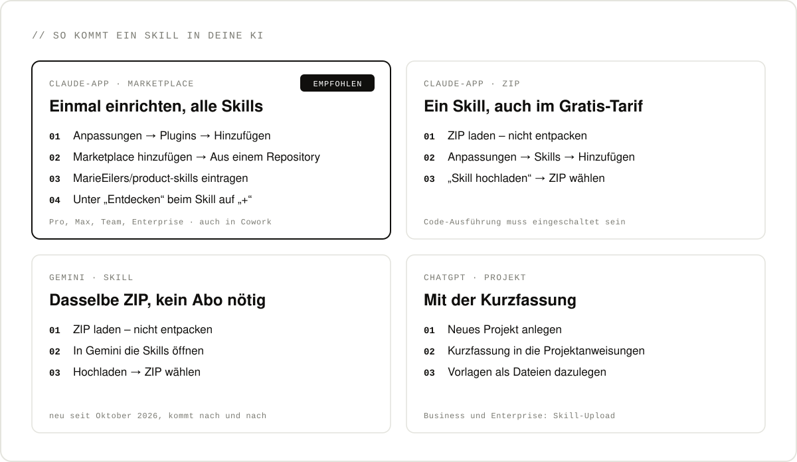
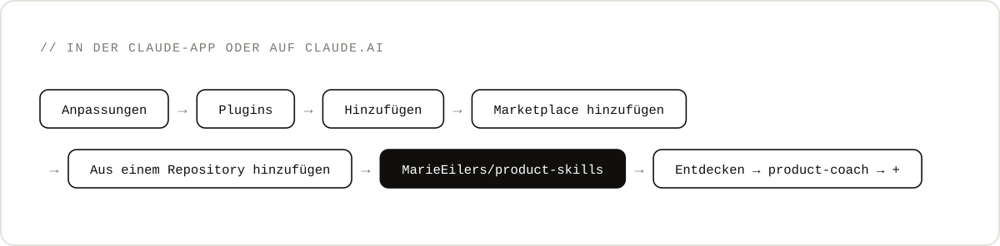

<p align="right"><a href="README.md">English</a> · <b>Deutsch</b></p>

<p align="center">
  
</p>

## Warum

Product Owner sind oft allein in ihrer Funktion – und unter Druck von allen Rollen um sie herum: Vertrieb, Entwicklung, Management, Kunden. Und die KI findet jede Idee großartig.

**Ja-Sager hast du genug.** Die Skills hier nicken nicht ab: Gegenwind, wenn du danebenliegst, Rückenwind, wenn du recht hast – bis deine Entscheidung trägt.

## Die Skills

| Skill | Was er für dich tut | Holen |
|---|---|---|
| **[Product Coach](doku/product-coach.md)** | Nickt nichts ab, bis deine Entscheidung trägt – auch an einem ganz normalen Montag. Legt Annahmen frei, merkt, wann du vom Produktmodell in den Projektmodus rutschst, und gibt dir ehrliches, hartes Feedback zu deiner Rolle und deiner Aufgabe. | [ZIP](https://github.com/MarieEilers/product-skills/releases/latest/download/product-coach.zip) · [Kurzfassung für ChatGPT](doku/product-coach-kurzfassung.md) · [Blogbeitrag](https://marieeilers.github.io/sudo-make-it-simple/beitraege/product-coach/) |

Weitere Skills kommen dazu. Alle Skills antworten in der Sprache, in der du schreibst – Deutsch, Englisch, Französisch und mehr.

## So kommt ein Skill in deine KI



### Claude-App über den Marketplace – empfohlen

Einmal einrichten, danach stehen dir alle Skills dieses Marketplace zur Verfügung – im Chat und in Cowork, in der Desktop-App und auf claude.ai. Geht mit Pro, Max, Team und Enterprise.



1. Öffne **Anpassungen** → **Plugins** → **Hinzufügen** → **Marketplace hinzufügen**.
2. Wähle **Aus einem Repository hinzufügen** und trag `MarieEilers/product-skills` ein.
3. Wechsle zu **Entdecken**, such **product-coach** und klick auf **+**.
4. Starte einen neuen Chat und leg los: *„Coach mich auf eine Situation: …“*

Neue Skills kommen dazu, sobald du den Marketplace aktualisierst – oder von selbst, wenn du das automatische Synchronisieren einschaltest.

### Claude-App per ZIP – ein einzelner Skill, auch im Gratis-Tarif

1. Lade das ZIP herunter, zum Beispiel [product-coach.zip](https://github.com/MarieEilers/product-skills/releases/latest/download/product-coach.zip). **Nicht entpacken.**
2. Öffne **Anpassungen** → **Skills** → **Hinzufügen** → **Skill hochladen** und wähle das ZIP.
3. Starte einen neuen Chat.

Klappt das Hochladen nicht, schalte in den **Einstellungen** unter **Funktionen** die Code-Ausführung ein.

### Gemini – dasselbe ZIP

Gemini lädt seit Oktober 2026 dieselben Skills. Ein Abo brauchst du dafür nicht, die Funktion kommt aber nach und nach bei allen an.

1. Lade das [ZIP](https://github.com/MarieEilers/product-skills/releases/latest/download/product-coach.zip) herunter.
2. Öffne in Gemini die **Skills** und lade das ZIP hoch.
3. Starte einen neuen Chat.

### ChatGPT – als Projekt mit der Kurzfassung

Skills hochladen geht in ChatGPT nur mit Business- und Enterprise-Konten. Für alle anderen gibt es die [Kurzfassung](doku/product-coach-kurzfassung.md): gleiche Haltung, weniger Tiefe.

1. Leg ein **neues Projekt** an.
2. Kopier die Kurzfassung in die **Anweisungen** des Projekts.
3. Leg die [Vorlagen](plugins/product-coach/templates) als Dateien dazu. Das ist optional.

### Claude Code – im Terminal

```text
/plugin marketplace add MarieEilers/product-skills
/plugin install product-coach@product-skills
```

## Deine Daten

Ein Skill besteht aus Anweisungen und Vorlagen. Es gibt keinen eigenen Server und keine Datensammlung. Für das Gespräch gelten die Datenregeln deiner KI. Die Beispiele in den Vorlagen sind erfunden.

---

<p align="center"><code>$ sudo make it simple</code></p>
<p align="center"><a href="LICENSE">MIT</a> · Marie Christin Eilers · <a href="https://marieeilers.github.io/sudo-make-it-simple/">Blog</a> · <a href="https://www.linkedin.com/in/marieeilers/">LinkedIn</a> · <a href="https://github.com/MarieEilers">GitHub</a></p>
