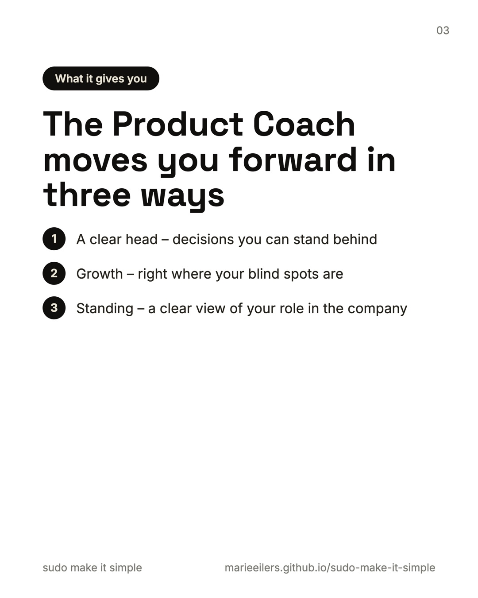
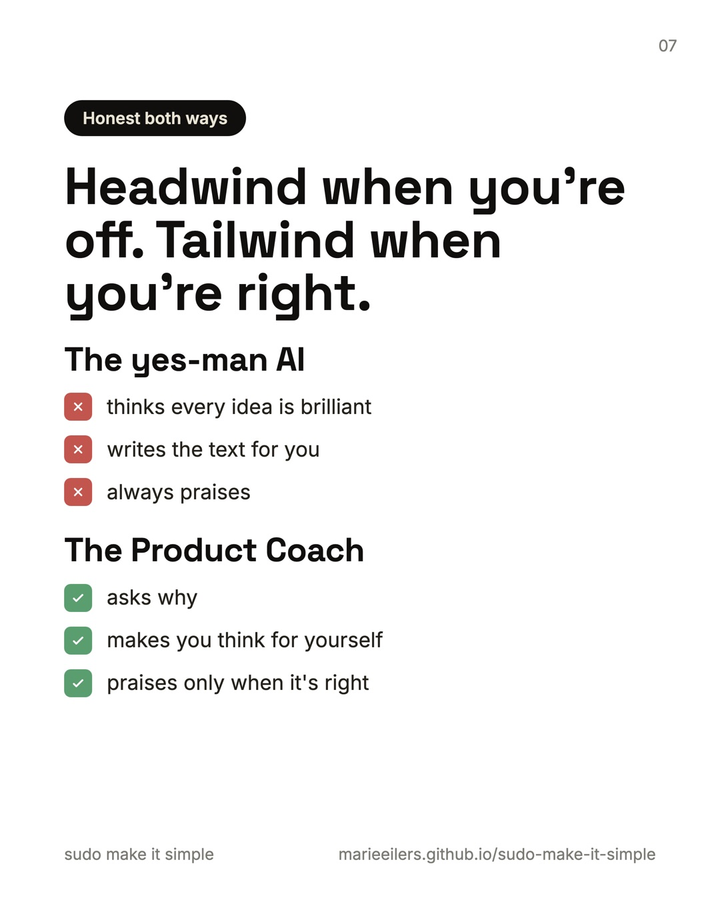
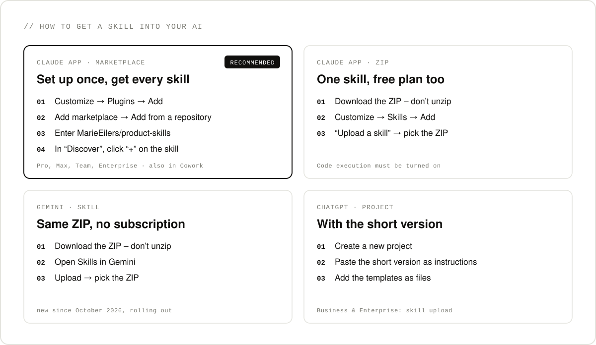
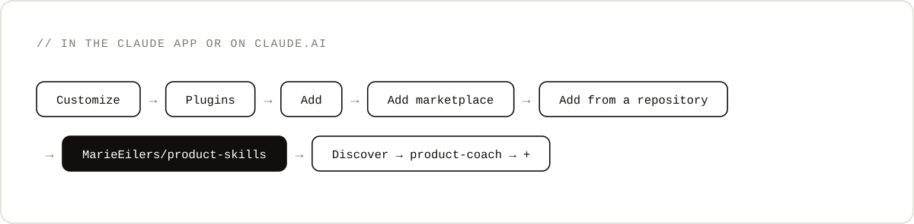

<p align="right"><b>English</b> · <a href="README.de.md">Deutsch</a></p>

<p align="center">
  
</p>

## Why

Product owners are often alone in their role – and under pressure from every role around them: sales, engineering, management, customers. And your AI thinks every idea is brilliant.

**You have enough yes-men.** These skills don't nod along: headwind when you're off, tailwind when you're right – until your decision holds up.

<p align="center">
  
  
  
</p>
<p align="center"><sub>All ten slides: <a href="https://marieeilers.github.io/bluu/en/beitraege/product-coach/">on the blog</a> – feel free to share them.</sub></p>

## The skills

| Skill | What it does for you | Get it |
|---|---|---|
| <nobr><b>[Product&#8209;Coach](doku/product-coach.en.md)</b></nobr> | Doesn't nod anything through until your decision holds up – even on a perfectly ordinary Monday. Surfaces your assumptions, notices when you slide from the product model into project mode, and gives you honest, hard feedback on your role and your work. | [ZIP](https://github.com/MarieEilers/product-skills/releases/latest/download/product-coach.zip) · [Short version for ChatGPT](doku/product-coach-short-version.md) |

More skills are on the way. All skills answer in the language you write in – English, German, French and more.

## How to get a skill into your AI



### Claude app via the marketplace – recommended

Set it up once and every skill in this marketplace is available to you – in chat and in Cowork, in the desktop app and on claude.ai. Works with Pro, Max, Team and Enterprise.



1. Open **Customize** → **Plugins** → **Add** → **Add marketplace**.
2. Choose **Add from a repository** and enter `MarieEilers/product-skills`.
3. Switch to **Discover**, find **product-coach** and click **+**.
4. Start a new chat and go: *“Coach me on a situation: …”*

New skills arrive when you check the marketplace for updates – or by themselves if you turn on automatic sync.

### Claude app via ZIP – a single skill, free plan too

1. Download the ZIP, e.g. [product-coach.zip](https://github.com/MarieEilers/product-skills/releases/latest/download/product-coach.zip). **Don't unzip it.**
2. Open **Customize** → **Skills** → **Add** → **Upload a skill** and pick the ZIP.
3. Start a new chat.

If the upload doesn't work, turn on code execution under **Settings** → **Capabilities**.

### Gemini – the same ZIP

Since October 2026, Gemini can load the same skills. No subscription needed; the feature is rolling out gradually.

1. Download the [ZIP](https://github.com/MarieEilers/product-skills/releases/latest/download/product-coach.zip).
2. Open **Skills** in Gemini and upload the ZIP.
3. Start a new chat.

### ChatGPT – as a project with the short version

In ChatGPT, uploading skills only works with Business and Enterprise accounts. For everyone else there's the [short version](doku/product-coach-short-version.md): same attitude, less depth.

1. Create a **new project**.
2. Paste the short version into the project's **instructions**.
3. Add the [templates](plugins/product-coach/templates) as files. Optional.

### Claude Code – in the terminal

```text
/plugin marketplace add MarieEilers/product-skills
/plugin install product-coach@product-skills
```

## Your data

A skill consists of instructions and templates. No server of its own, no data collection. Your conversation is governed by the privacy terms of your AI. The examples in the templates are fictional.

---

<p align="center"><code>BLUU · Build less. Understand users.</code></p>
<p align="center"><a href="LICENSE">MIT</a> · Marie Christin Eilers · <a href="https://marieeilers.github.io/bluu/">Blog</a> · <a href="https://www.linkedin.com/in/marieeilers/">LinkedIn</a> · <a href="https://github.com/MarieEilers">GitHub</a></p>
