# Product Coach

**A Claude skill for permanent coaching. Headwind when you're off. Tailwind when you're right.**

[← All skills](../README.md) · [Get it into your AI](../README.md#how-to-get-a-skill-into-your-ai) · [Short version for ChatGPT](product-coach-short-version.md) · [Deutsch](product-coach.md)

## Why

Product owners are often alone in their role and under pressure from every role around them. Honest sparring for product decisions? **404 – not found.** The Product Coach doesn't write a single line for you – it gives you honest, hard feedback on your role and your work.

## What it looks like

Real session, fictional case, shortened, translated from German. The coach answers in the language you write in.

## You don't need a crisis. A normal Monday will do.

Four ways to start:

| Mode | Say, for example |
|---|---|
| **Situation** | “Coach me: sales wants …” |
| **Critique** | “Take this story apart: …” |
| **Skill-Building** | “Test me on metrics.” |
| **Context-Sharpening** | “Is this our strategy – or just a goal?” |

## What it doesn't do

No Jira stories. No stakeholder emails. No slides. No pats on the back.

## What's in the package

| File | Purpose |
|---|---|
| `SKILL.md` | Attitude, four modes, anti-patterns, how a session runs |
| `templates/01-strategic-context.md` | Template: your role, products, stakeholders, constraints |
| `templates/02-current-themes.md` | Template: your current topics |
| `templates/03-reference-frameworks.md` | Shared vocabulary: Cagan, Follett, Patton, Torres, Team Topologies |
| `templates/04-coaching-log.md` | Template: what you take away from sessions, in your own words |
| `templates/05-privat-notizen.md` | Just for you, stays out of the conversation |

The skill and its templates are written in German; the coach translates the templates into your language when it sets them up with you. You don't need to fill in anything up front. The examples in the templates are fictional.

## Sources

Marty Cagan: *Inspired*, *Empowered* (with Chris Jones), *Transformed* · Jeff Patton: *User Story Mapping* · Mary Parker Follett: *Dynamic Administration* · Teresa Torres: *Continuous Discovery Habits* · Matthew Skelton, Manuel Pais: *Team Topologies*

Background (German): [404: Sparringspartner not found](https://marieeilers.github.io/sudo-make-it-simple/beitraege/product-coach/)
