# Product Coach

**Ein Claude-Skill für permanentes Coaching. Gegenwind statt Schulterklopfen.**

[← Alle Skills](../README.md) · [In deine KI bringen](../README.md#so-kommt-ein-skill-in-deine-ki) · [Kurzfassung für ChatGPT](product-coach-kurzfassung.md)

## Warum

Product Owner entscheiden oft allein. Ehrliches Sparring für Produktentscheidungen? **404 – not found.** Der Product Coach schreibt dir keine Zeile – er gibt dir ehrliches, hartes Feedback zu deiner Rolle und deiner Aufgabe.

## So sieht das aus

Echte Sitzung, erfundener Fall, gekürzt.

## Du brauchst keine Krise. Ein normaler Montag reicht.

Vier Sätze, mit denen du einsteigst:

| Modus | Sag zum Beispiel |
|---|---|
| **Situation** | „Coach mich: Der Vertrieb will …“ |
| **Critique** | „Zerleg diese Story: …“ |
| **Skill-Building** | „Prüf mich bei Metriken.“ |
| **Context-Sharpening** | „Ist das unsere Strategie – oder nur ein Ziel?“ |

## Was er nicht macht

Keine Jira-Stories. Keine Stakeholder-Mails. Keine Folien. Kein Schulterklopfen.

## Was im Paket steckt

| Datei | Wofür |
|---|---|
| `SKILL.md` | Haltung, vier Modi, Anti-Muster, Ablauf einer Sitzung |
| `templates/01-strategic-context.md` | Vorlage: deine Rolle, Produkte, Stakeholder, Zwänge |
| `templates/02-current-themes.md` | Vorlage: deine aktuellen Themen |
| `templates/03-reference-frameworks.md` | gemeinsames Vokabular: Cagan, Follett, Patton, Torres, Team Topologies |
| `templates/04-coaching-log.md` | Vorlage: was du aus Sitzungen mitnimmst, in deinen Worten |
| `templates/05-privat-notizen.md` | nur für dich, gehört nicht ins Gespräch |

Du musst vorab nichts ausfüllen. Die Beispiele in den Vorlagen sind erfunden.

## Quellen

Marty Cagan: *Inspired*, *Empowered* (mit Chris Jones), *Transformed* · Jeff Patton: *User Story Mapping* · Mary Parker Follett: *Dynamic Administration* · Teresa Torres: *Continuous Discovery Habits* · Matthew Skelton, Manuel Pais: *Team Topologies*
